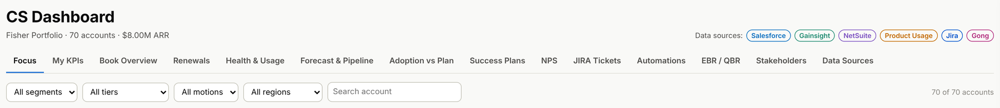
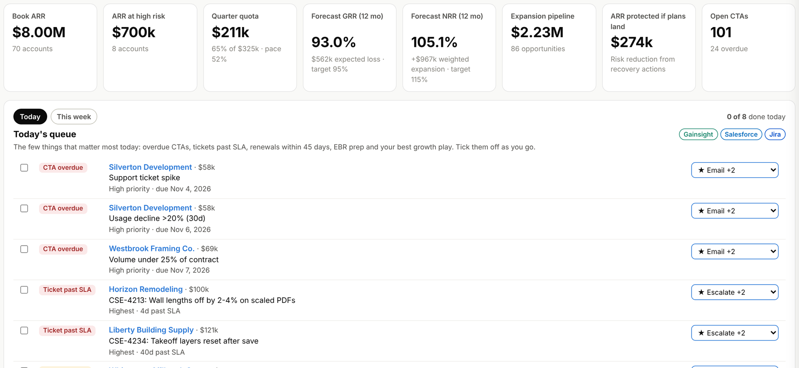
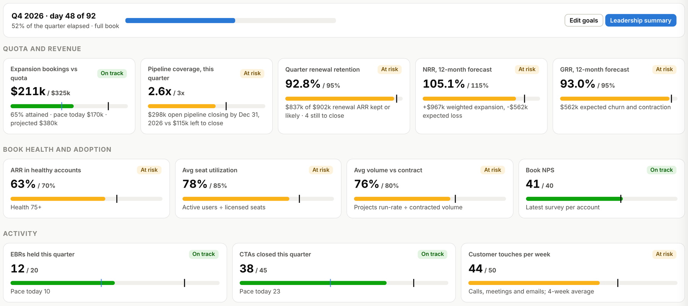
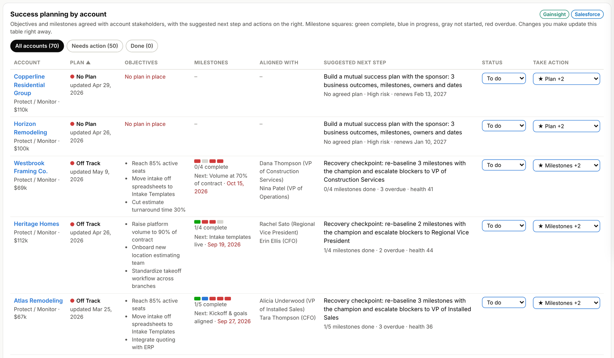
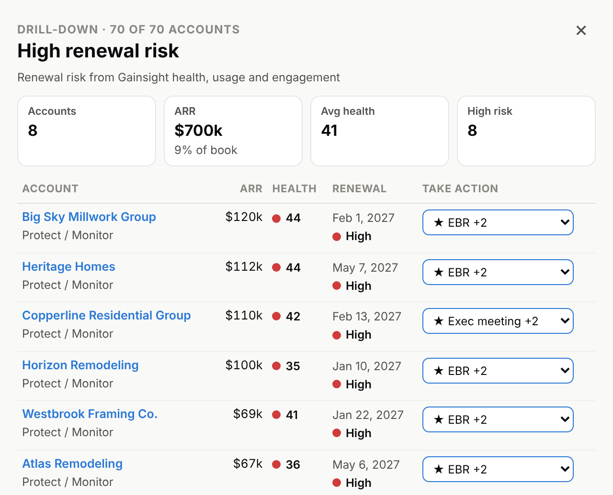

# CS Dashboard: an AI-powered retention, adoption and growth engine

An AI-powered Customer Success dashboard I designed and built from scratch with Claude. It turns signals from across the CS stack (CRM, CS platform, billing, product usage, support tickets and call recordings) into a short list of daily actions for retention, adoption and growth.

It's modeled on the system I ran for a $7M book of business, and it's built as a template that can be tailored to a new team's products, goals and tools.

> All accounts, contacts and numbers in this dashboard are **sample data**.

## Try it

- **Live demo:** open `index.html` in any browser, or visit the GitHub Pages link once enabled (see below).
- No install, no server and no login. Everything runs in one HTML file.

## What it does

| View | What it answers |
|---|---|
| **Focus** | What do I do today? Daily queue, Monday brief, top actions, churn risk, expansion signals |
| **My KPIs** | Am I on track this quarter? Quota with pace, path to quota, retention, adoption and activity goals |
| **Book Overview** | How healthy is my book? ARR by tier, health mix, health vs. renewal timing |
| **Renewals** | What's renewing, when, and how risky is it? |
| **Health & Usage** | Who's adopting, who's slipping, and which features are underused? |
| **Forecast & Pipeline** | GRR/NRR forecast, expansion pipeline and whitespace by product |
| **Adoption vs Plan** | Is usage meeting the targets customers agreed to in their success plan? |
| **Success Plans** | Plan status, milestones and the next step for every account |
| **NPS** | Sentiment trends, detractors to follow up, promoters to ask for references |
| **JIRA Tickets** | Open engineering tickets, SLA breaches and ticket spikes by account |
| **Automations** | CTAs, email nudges and in-app messages, with their impact on adoption |
| **EBR / QBR** | Which business reviews to schedule, prioritized by churn risk |
| **Stakeholders** | Executive, manager and end-user coverage for each account |

### Highlights
- **A suggested next step on every account.** Take action dropdowns mark the suggested actions with ★, chosen for each account's situation.
- **Drafts the work.** Customer emails, renewal quotes, Jira escalations, business cases and a leadership summary, ready to copy.
- **Drill-down everywhere.** Click any KPI, chart bar or scorecard to see the accounts, opportunities or tickets behind it.
- **Built for a daily, weekly and quarterly rhythm.** Today's queue, a Monday brief, and quarterly goals tracked against pace.

## Screenshots

| Daily focus | Quarterly KPIs |
|---|---|
|  |  |

| Success plans with Take action | Drill-down: high-risk accounts |
|---|---|
|  |  |

## How it's built
- One self-contained HTML file (vanilla JavaScript and SVG charts, no frameworks).
- Designed by me: health model, risk rules, KPIs, success-plan logic and action playbooks. Code built with [Claude](https://claude.ai).
- Data sources modeled: Salesforce, Gainsight, NetSuite, Jira, Gong and product usage.
- Your actions (statuses, notes, CTAs, goals) are saved in your browser only. Nothing is sent anywhere.

## Make it your own
The template can be tailored to:
- your product lines, pricing model and tiers
- your health score weights and risk thresholds
- your quarterly goals (use **Edit goals** on the My KPIs tab)
- your own data, by replacing the sample data in the file

## About
Built by **James Fisher**: Customer Success, retention, adoption and account growth.
[LinkedIn](https://www.linkedin.com/in/james-m-fisher)
